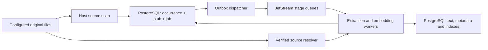

# Ingestion Design

This document is the design authority for Pocket Advisor’s write path: source discovery, discovery, extraction, indexing, queues, failure handling, runtime composition, and ingestion observability. [PDF text extraction](pdf-to-text.md) owns PDF classification, layout reconstruction, rasterisation, and OCR. [Workspace isolation](workspace-isolation.md) owns credentials and store boundaries. [Retrieval](retrieval-design.md) owns the read path over the index produced here.

## 1. Current state

One host Go process discovers original files, dispatches durable ingestion jobs, and runs five JetStream stage pools. Kubernetes supplies PostgreSQL and NATS. Directories configured in the private workspace registry are authoritative for original bytes; the application never writes them. PostgreSQL retains normalized text, structured metadata, shared passages, placements, and search indexes. No object store or permanent attachment-byte directory is required.

Document identity is an opaque UUID, independent of its unique per-workspace raw SHA-256. Moves and identical copies preserve that identity; changed bytes create a new content identity. Every indexed passage is an exact UTF-8 byte slice of canonical normalized text. Generated answers never enter the index. Jobs use at-least-once delivery with transactional stage completion.



## 2. Source inventory and identity

### 2.1 Original files and replayable members

`source_roots` assigns opaque root IDs to SHA-256 bindings of cleaned absolute configured directories. Absolute directories resolve only from the private registry; bindings and relative paths are private database metadata. Root order does not affect identity. A relocated directory gets a new binding on a complete rescan.

`source_occurrences` records each root-relative path, document UUID, display path, size, mtime, scan ID, observation time, and availability. Identical files retain separate occurrences. `source_scans` records starts and successful completion; only successful full traversal marks old occurrences unavailable. Partial scans may add observations but cannot prove absence. Human display paths include a root basename when multiple roots are configured.

`source_members` records every parent/member-selector/child occurrence, including repeated filenames and shared attachments. MIME selectors are versioned decoded-child ordinals; ZIP and TAR selectors use original member ordinals. `document_placements` remains the complete containment graph used for retention. A single `parent_doc_id` cannot select all sources or establish retention.

A `source:<document UUID>` reference is interpreted only inside the selected workspace. The resolver tries direct occurrences and alternative parent routes, reopens the configured original, and verifies SHA-256 over bytes actually handed to extraction. Every child replay verifies the decoded child's content hash. It never accepts a caller-supplied host path or substitutes changed bytes under an old identity.

Reads use `os.Root` confinement, reject observed symlinks, traversal and special files, apply ignore rules, and compare descriptor attributes before and after reading. Each original is limited to 256 MiB; replay is bounded to eight container levels and 512 MiB of cumulative decoded bytes, including siblings. MIME and archive parsing rejects truncated or over-limit members. Buffers are transient; sources remain read-only. Workers have a bounded handler deadline, and file reads check cancellation between reads.

Missing originals or changed bytes are separate waiting outcomes. PostgreSQL evidence can still be retrieved while an original is offline, but reprocessing and rebuilding require the original hash to be recoverable. Current paths do not preserve overwritten historical bytes: source-side versioning or backups are the operator's responsibility.

### 2.2 Tier 2: PostgreSQL documents

doc_id and raw_sha256 are two independent identities on the same row, not one value serving both purposes:

- `doc_id` is a random UUIDv4 (`domain.NewDocID`), assigned once and never derived from anything — a short, indexable key that lets every other table (chunks, email metadata, topic mentions) cross-reference one document cheaply. It carries no information about content, workspace, or placement.
- `raw_sha256` is the actual content identity: a `UNIQUE` constraint (`documents_raw_sha256_key`) makes it, not doc_id, the idempotency key. `CreateStub` inserts a candidate doc_id but upserts on `raw_sha256` (`ON CONFLICT (raw_sha256) DO UPDATE ... RETURNING doc_id`), so re-scanning a workspace, retrying a failed publish, and two racing intake requests for the same bytes all resolve to whichever doc_id first claimed that content — the candidate id a caller generated is only used if the content is genuinely new.

This is what makes moving a file within a workspace, reorganizing a workspace's directory layout, or renaming a workspace itself an ordinary metadata change rather than a re-identification: nothing about a document's identity is derived from where it currently lives.

The `documents` table holds:

- parent/child and thread lineage;
- processing status;
- detected type and MIME type;
- source reference, raw content hash, canonical extraction hash and extraction version;
- original filename;
- extracted `normalized_text`;
- email subject, sender, recipients, and date as separate columns; and
- JSON metadata for provenance and failure details.

Email headers are not embedded into body text. `normalized_text` contains body prose, and metadata remains queryable as structured fields.

### 2.3 Tier 3: PostgreSQL chunks

A workspace stores each exact normalised passage once in `chunks`, keyed by its embedding model and `raw_sha256`, a SHA-256 of whitespace-collapsed text — the same content-identity role `documents.raw_sha256` plays one stage earlier in the pipeline, over raw file bytes rather than normalised chunk text. `chunks.chunk_id` is that row's own opaque, randomly generated identity (`domain.NewDocID`-style, independent of `raw_sha256` for the same reason `documents.doc_id` is independent of `documents.raw_sha256`). The row also owns `chunk_text`, its `halfvec(N)` embedding, the HNSW cosine index, and the BM25 lexical index. Similar text is never merged: identity is exact after whitespace normalisation only.

`document_chunks` is the placement relation. Its own identity is `placement_id`, an opaque, randomly generated id (`domain.NewChunkID`, needing no more determinism than `doc_id` does — the same delete-then-insert replace this paragraph describes already makes a re-embed converge correctly regardless of what the new placement ids happen to be). `chunk_id` here is a foreign key naming which shared passage this placement points at — the same name as `chunks`' own primary key, exactly the way `doc_id` names both `documents`' primary key and every foreign key that references it. Alongside `doc_id`, `chunk_index`, and the start and end byte offsets into that document's `normalized_text`, this is what lets retrieval search shared passages, join placements to recover document-specific provenance, and cite the matched placement rather than an arbitrary document sharing the same text. Replacing a document's chunks atomically creates or reuses passage rows, replaces its placements, and removes passages with no remaining placement.

The BM25 lexical index is a `pg_textsearch` index over `chunks.chunk_text` using the `simple` text configuration. It is not part of the base DDL. It remains available during ingestion and is created idempotently after a bounded run drains. Shared passage text still supplies the lexical index; returned candidate text comes from the exact placement slice of the owning document.

### 2.4 Schema bootstrap

The vector width is resolved by probing the configured embedding endpoint. The host applies the schema as the workspace’s own PostgreSQL role and records the embedding model and dimension in the single-row `schema_metadata` table.

Startup verifies that the endpoint’s model and vector width match `schema_metadata`. A mismatch is fatal. The current schema bootstrap is idempotent for an unchanged model and dimension; it is not a schema migration or re-embedding system.

**Target state:** a model change is handled as an explicit re-embed into a distinct model namespace, with the existing namespace remaining queryable until backfill and cutover complete. The migration and backfill workflow is not implemented.

Structural source migration is transactional, repeatable, and recorded in `application_migrations`. It preserves document UUIDs and existing evidence, renames the source column, adds inventory and jobs, and refuses unresolved legacy object-deletion requests. Canonical text gains an exact SHA-256; existing text is labelled `legacy-canonical`, and new extraction uses `canonical-v1`. This version identifies the current canonicalization contract, not a promise of bit-identical OCR across tool upgrades. Containment backfill reads verified originals separately. See the operational compatibility gate in [README §11](../README.md#11-upgrade-and-teardown).

### 2.5 Email message metadata and conversations

Email messages carry a second layer of Tier 2 state alongside their `documents` row. `documents` keeps the display-form subject, sender, recipients, and date that evidence renders; the tables below keep the structured identities a browse query filters and sorts on, and the graph conversations are reconstructed from.

| Table | Contents |
| --- | --- |
| `email_messages` | one row per message document: canonical `Message-ID`, raw and normalized subject, parsed `sent_at`, separate `ingested_at`, bounded automated class and `List-Id`, the assigned conversation and the method that assigned it, typed parse warnings, and the parser version |
| `email_addresses` | parsed mailboxes by header kind and header order, each with its normalized address, display name, original raw text, and whether it parsed |
| `email_references` | `In-Reply-To` and `References` identifiers as written, in header order |
| `email_identifier_nodes` | the workspace's identifier graph: one node per identifier ever seen, the document that owns it when there is one, and the component it belongs to |

Nothing is fabricated. A missing or malformed header produces an empty value and a typed warning; an unparsable mailbox keeps its raw text with an empty address, so no exact mailbox or sender-domain filter can match it and the defect stays visible. `sent_at` is the message's own `Date` and is null when that was absent or unparsable. `ingested_at` is when the row was written; it is the watermark a stable browse cursor pages against and does not move when a document is reprocessed.

A conversation is a connected component of the identifier graph. A message's identifier set is its own `Message-ID` when present, plus every `In-Reply-To` and `References` entry. Folding a message in unions the components of that set and keeps the lexicographically smallest component id, so a conversation depends on which messages a workspace holds and not on the order they arrived in. An identifier named only by a reply becomes a placeholder node with no document behind it: a conversation survives a missing ancestor, and no document row is invented to stand in for one. A `Message-ID` claimed by a second document stays with the first writer — the second is stored, joins the same conversation, and records a `duplicate_message_id` warning rather than retargeting the identifier.

`conversation_method` is stored rather than inferred at read time, because a heuristic grouping must never be presented as an exact one: `references` for a message carrying any identifier, `subject_fallback` for a header orphan grouped by normalized subject *and* its sender within its workspace, `isolated` for a message with neither a usable subject and sender pair nor an identifier. Subject normalization is conservative — lowercasing, trimming, and removing stacked reply and forward prefixes — the sender keeps a recurring subject such as an invoice notice from collapsing unrelated correspondents into one conversation, and a subject group is never merged into an identifier component.

Indexes cover conversation lookup, exact address-and-kind matching, exact sender-domain matching, the `sent_at DESC NULLS LAST, doc_id DESC` browse keyset, the `ingested_at` watermark, and identifier and component lookup.

One message's metadata is written in a single transaction, serialized per workspace so that concurrent workers cannot plan a component merge against a graph the other is rewriting. The write is idempotent for a given `doc_id`: mailboxes and reply headers are replaced rather than appended, and component identity is derived from identifiers rather than minted per run, so re-ingesting a message from verified originals reproduces the same conversation.

#### Reprocessing existing documents

`--reprocess-email-metadata` is the supported way for documents older than these tables to gain the metadata. It walks one workspace's email message documents in `doc_id` order, reads each one's authoritative original source, and writes the result through the same parser, the same header mapping, and the same repository transaction the email worker uses. There is no second parser and no second write path.

It is a maintenance walk rather than an ingest: nothing is admitted, enqueued, extracted, re-chunked, or re-embedded, and the `documents` row, its text, its thread id, and its processing status are left untouched. Archives and non-email documents are out of scope. An email row with no original source is selected and reported as unreadable; it is never rebuilt from Tier 2 values. Concurrency is bounded, the keyset cursor makes an interrupted run resumable, and cancellation stops the walk and reports what it completed.

A run reports processed, updated, unreadable, and failed counts, with a closed set of reason codes behind the last two. `unreadable` is a document whose original bytes could not be read at all; `failed` is bytes that were read and could not be turned into metadata. Neither is repaired and neither is skipped silently — nothing but the message can say what the message said — and a run that ends with either count above zero exits with failure. `--dry-run` reports the same counts without writing, `--reprocess-missing-only` narrows selection to documents with no metadata row yet, and `--reprocess-limit` bounds one run. Only aggregate counts and closed-set outcome codes are logged: no subject, address, identifier, or source path reaches a summary or a log line.

Reply edges are derived per conversation at read time: an unambiguous `In-Reply-To` owner is `in_reply_to`; otherwise the nearest resolvable `References` ancestor is `references_recovery`. Ambiguous, damaged, or unavailable linkage is `unresolved` with warnings, and a message with no parent evidence is `root`. Exact browse, conversation fetch, and awaiting-reply queries read these tables, using configured workspace owner identities for direction; their semantics are described in [retrieval design](retrieval-design.md).

### 2.6 Replaceable email topic mentions

A topic graph version is a replaceable Tier 2 derived layer over canonical root email `normalized_text`; it does not alter documents, chunks, email metadata, conversations, or exact reply relationships. A version begins `BUILDING` with immutable extraction/configuration versions and bounds, becomes `READY` only through explicit finalization, and becomes `ACTIVE` only through promotion. Promotion atomically retires the previous active version, so a build never changes active results. Operators may explicitly retire an active version, and may remove only `BUILDING` or `RETIRED` versions with their derived annotations.

`--topic-graph-build` is the bounded fixed-workspace write path. It requires a new version UUID and a source-message cap, takes one PostgreSQL `ingested_at` watermark, and keyset-walks only root `documents` that are parsed email messages with nonempty persisted normalized text. Children and attachments, header-only messages, and messages arriving after the watermark are excluded. For each selected message, `topicgraph.LocalLLMExtractor` sends only the bounded canonical body to the configured local LLM endpoint, validates the returned UTF-8 source offsets and hashes, then replaces that document's mentions only in the `BUILDING` version. An empty extraction is a valid replacement. A failed extraction or replacement is reported as a closed aggregate reason and does not delete the target's existing annotations.

The build's `--dry-run` makes the same bounded selection and local extraction calls but creates no version and writes no mention or relation. Summaries and topic-build logs contain only aggregate counts and closed reason codes; they never contain source text, labels, prompts, completions, document identifiers, graph-version identifiers, email headers, or workspace names. After a complete non-dry build persists its mentions, it selects a bounded candidate set solely from exact `In-Reply-To` and `References` links between parsed messages in that version. The configured local relation classifier sees the candidates' exact cited source spans, not labels, subjects, embeddings, summaries, or a semantic neighbourhood. It returns strict JSON from the closed relation vocabulary and may decline a candidate; outputs below the configured confidence threshold are declined. This classifier runs only in the explicit build, never during email ingestion.

Topic relations and episodes are a second replaceable BUILDING-only layer in the same graph version. Each accepted local classification records its method and version and its two endpoint mentions as support. Repository validation proves fixed-workspace/version membership, applies the `sent_at` then immutable `doc_id` ordering (`NULL` dates sort last), and rejects cycles before a supported candidate becomes an edge. Episodes are recreated only as undirected connected components of supported edges, so declined candidates and similar or identically labelled mentions do not join one. Finalization, promotion, retirement, and removal are separate explicit CLI operations. The fixed-workspace, transport-independent topic timeline service reads only the active graph. It accepts server-issued opaque mention or episode references, pins the active graph version in a read snapshot, and walks supported edges backward and forward under explicit depth, node, cited-source-byte, and latency bounds. It returns chronologically ordered source-range citations, relation type and confidence, graph version, warnings, and omitted-node counts. Labels are never returned as evidence or facts; every returned node has validated canonical document ranges. Retrieval may opt in to graph expansion only after ordinary packet selection, using high-confidence validated spans and the shared evidence budget; it never displaces ordinary packets. The fixed-workspace `topic_timeline` MCP tool exposes bounded timeline reads under the same source-evidence and response-bound rules.

## 3. Discovery and reconciliation

The workspace's `paths` and ordered ignore rules define eligible regular files. Relative roots resolve against the registry directory, and multiple roots require distinct basenames. Each scan fully reads and hashes originals, including unchanged mtime/size observations. Platform metadata files are excluded. There is no watcher dependency; `--listen` scans at startup and every minute. Changes to registry configuration require restarting the process.

Each accepted original commits its conflict-safe document stub, source occurrence, and next-stage outbox job together. Completed, skipped, and failed documents are not automatically re-extracted. Existing containers are replayed to refresh known member routes. New supported plain text commits canonical text and its embed job together.

Discovery stops at the configured high-water mark of unfinished durable jobs and resumes at the low-water mark. Its live raw input buffer is one file. A container can add at most its bounded member count of downstream jobs in one transaction, so fan-out can temporarily exceed the intake threshold.

`--ingest-all` binds known sources and prunes before starting workers unless `--no-prune` is selected. `--scan` performs additive discovery and drains work. `--reconcile` refreshes sources and reissues unfinished jobs, including broker-lost commands, with a new dispatch generation. Legacy nonterminal rows without durable jobs are admitted from existing normalized text or verified originals. Terminal failures require explicit recovery.

`--ingest-all --dry-run` only hashes configured files and reports file/byte counts. It opens no database, broker, or model connection and writes no derived state.

`--audit-sources` reads configured files and recursively checks the hashes of retained documents. The conservative audit requires a known original document at each replay chain's root. It reports aggregate availability and parsing failures without persisting anything. `--bind-sources` requires that coverage, persists occurrences and replay recipes, verifies resolvability, and completes containment backfill. Unresolved coverage blocks object-store retirement.

## 4. Routing and extraction

Discovery classifies bytes rather than trusting extensions.

| Detected content | Subject | Handler |
| --- | --- | --- |
| RFC 822 email | `ingest.emails.raw` | email worker |
| ZIP, tar, and tar.gz archives | `ingest.emails.raw` | container unrolling |
| detected 7z and bzip2 archives | `ingest.emails.raw` | currently fail as unsupported during unrolling |
| PDF | `ingest.pdfs.raw` | document worker |
| DOCX, XLSX, PPTX, ODT, RTF | `ingest.docx.raw` | office worker |
| image | `ingest.images.raw` | image viability and OCR |
| plain text, Markdown, CSV, HTML | `ingest.text.embed` | direct indexing |
| CFBF Office and Outlook MSG | none | `SKIPPED / UNSUPPORTED_FORMAT` |
| other unsupported content | none | `SKIPPED / UNSUPPORTED_FORMAT` |

### 4.1 Email and archive worker

The email worker parses RFC 822 messages and supported archives in memory. It:

- extracts and compacts body text;
- strips markup, quoted reply chains, signature boilerplate, and machine-generated tracking URLs over the configured structural threshold;
- records headers in structured columns;
- persists the durable message metadata and conversation assignment described in §2.5;
- derives thread ids from message headers, with subject/participant/date fallback;
- records child replay selectors and containment without persisting child bytes;
- commits child stubs and all downstream job intents with the parent stage; and
- enforces nesting and expansion bounds for hostile containers.

Child commands carry `parent_doc_id`, thread context, depth, and the parent trace id. Root creation remains exclusive to discovery.

### 4.2 PDF and image worker

The document worker has separate PDF and image consumer pools sharing one extraction implementation and one process-wide CPU semaphore. PDF extraction, masking, layout, rasterisation, OCR, page ordering, and image viability are specified in [PDF to Text](pdf-to-text.md).

OCR is compiled behind the `ocr` build tag. The supported build command enables it. A binary built without that tag remains usable but records scanned PDFs and images as `SKIPPED / OCR_UNAVAILABLE`.

### 4.3 Office worker

The pure-Go office worker handles:

- DOCX paragraphs and row-wise tables;
- XLSX sheets and tab-separated rows, using cached formula values;
- PPTX slide text and notes;
- ODT text; and
- RTF control-word stripping.

Row-wise spreadsheet output preserves the relationship between fields such as dates, descriptions, and amounts.

### 4.4 Plain text

Discovery writes supported plain text directly to `documents.normalized_text` before publishing `EmbedTextCommand`. Commands carry references, not document content.

## 5. Commands and queues

Every ingestion command is Protobuf and begins with `DocumentMetadata` containing document identity, lineage, MIME type, content hash, trace context, and container depth.

| Command | Subject | Payload role |
| --- | --- | --- |
| `ProcessEmailCommand` | `ingest.emails.raw` | source reference and metadata |
| `ProcessPdfCommand` | `ingest.pdfs.raw` | source reference and metadata |
| `ProcessOfficeCommand` | `ingest.docx.raw` | source reference, subtype, metadata |
| `ProcessImageCommand` | `ingest.images.raw` | source reference, dimensions, size, metadata |
| `EmbedTextCommand` | `ingest.text.embed` | document reference and text length |

Extracted text is written to Tier 2 before an embed command is published. This keeps large OCR output below NATS payload limits and gives `normalized_text` one durable owner.

The workspace has two namespaced streams: `INGESTION` with work-queue retention over the five stage subjects, and `INGESTION_DLQ` with limits retention for terminal failures. `deploy-workspaces` provisions both. There is no notification stream. Protobuf commands reserve retired field number 2 and carry the source reference in field 10; old and new consumers must not overlap.

## 6. Durable handoff, failure and retention

### 6.1 Transactional jobs

`ingestion_jobs` is both the durable work record and transactional outbox. Its unique identity is document, stage subject, and content revision; embedding also binds the canonical-text hash. Payloads contain references and metadata, never document bodies. A dispatcher leases READY entries for 30 seconds, publishes with acknowledgement, and records DISPATCHED. `Nats-Msg-Id` combines immutable job ID and dispatch generation. Failed or ambiguous publication retries the same identity.

The runtime verifies job identity, subject, exact stored payload, and dispatch generation. A transaction advisory lock and row lock serialize duplicate deliveries; stale generations and jobs removed by pruning acknowledge as no-ops. The handler's writes, child/embedding intents, and COMPLETED state commit together. Nested repositories use savepoints on the stage transaction. Completed jobs are not rerun even after the broker deduplication window expires.

The current implementation holds one database transaction through extraction/model work, bounded by the one-hour handler deadline. This favors atomicity and requires monitoring long transactions and vacuum pressure. A process-wide job gate reserves three pool connections for scanning, dispatch, and maintenance; ingestion requires at least four connections. A future short-transaction claim/fence design must preserve the same commit guarantees.

### 6.2 Failures and recovery

Consumers acknowledge explicitly, permit unlimited broker redelivery, and heartbeat under the bounded handler deadline. Expected declines commit SKIPPED without dead-lettering. Transient failures use jittered delayed NAK. Terminal failures, or errors reaching the application retry threshold, publish the original command to the DLQ before atomically recording failed job/document state; failed DLQ publication requests another delivery.

A missing or changed source records WAITING_SOURCE with a closed reason and acknowledges the broker message. Complete listener scans retry source waits; an explicit reconciliation also retries them. No changed bytes replace the expected revision. A finite run reports waiting and failed jobs as unresolved, even when broker queues are empty.

A process crash before stage commit leaves no partial stage effects. A crash after commit but before acknowledgement produces a completed-job no-op. A crash after outbox commit but before publication leaves READY work. Broker message loss is repaired from DISPATCHED jobs by explicit reconciliation with a new generation. `--recover --yes` resets only planner-approved retryable states and redrives their unfinished durable jobs; completed jobs stay complete.

### 6.3 Pruning and maintenance

A workspace-scoped advisory maintenance lock serializes ingestion, binding, recovery, forgetting, and destructive sweeps. Workers run only after the pre-ingest sweep. Retention is transitive reachability from current source hashes through all containment edges, so duplicate files and shared attachments survive while any configured route retains them.

Absence-based pruning requires complete traversal, a nonempty source set, complete containment backfill, and a deletion share within `--prune-max-share` (default 10%). A share refusal prints the plan and continues additive ingestion without deleting. Missing roots or incomplete traversal fail the run. `--reconcile-deletions` prepares derived inventory/containment and previews the plan; applying requires `--yes` and confirmation. The preview may refresh derived state but never deletes documents or writes original files.

Deletion removes derived rows, their jobs and placements, and unreferenced passages in a transaction. The parent foreign key is `ON DELETE SET NULL`; surviving display provenance is repointed where possible. Source occurrence/member tables provide the full citation paths. No object cleanup queue exists.

## 7. Chunking and embedding

The indexer loads `normalized_text` by `doc_id`, then:

1. splits it into approximately 512-token windows with 64-token overlap;
2. prefers paragraph, line, sentence, then word boundaries in the final 40% of a window;
3. preserves UTF-8 byte offsets so `normalized_text[start:end] == chunk_text`;
4. batches after chunking, with at most 64 chunks or approximately 16,000 tokens per embedding request;
5. embeds exactly `chunk_text`, without subject, filename, or parent context; and
6. replaces all chunks for the document transactionally.

A document may require several embedding requests, but no chunks become visible until the complete document transaction commits.

## 8. Process topology and concurrency

One process constructs shared store clients, model clients, logging, metrics, and a CPU semaphore. Pool sizes derive from `runtime.NumCPU()`:

| Pool | Lanes |
| --- | --- |
| email | `2 × CPU` |
| PDF | `CPU` |
| image | `CPU` |
| office | `CPU` |
| embedding | `2 × CPU` |
| rasterisation and OCR CPU semaphore | `CPU` shared slots |

Embedding concurrency is separately configurable because it is a capacity limit of the model endpoint rather than the host CPU. The database job gate limits concurrent stage transactions independently of lane count.

PDFium uses the wazero WebAssembly backend. Its instance pool is lazy and sized to the document lanes. Tesseract uses CGo. PDF rasterisation remains serial per document, while page OCR can run concurrently under the shared semaphore and stores results by page index.

## 9. Run lifecycle

A finite run starts the dispatcher and all stage pools, completes discovery, and waits for both unfinished durable jobs and broker/in-flight work to remain empty for three seconds. WAITING_SOURCE and FAILED jobs are reported as unresolved. A listener scans periodically and runs until interrupted.

The first interrupt stops intake and fetching while handlers drain. A second interrupt or grace-period expiry cancels handlers. Downstream intents committed during shutdown remain durable for the next run even if no dispatcher remains active.

## 10. Reset semantics

`--forget <sha256>` removes the selected document and exclusively held descendants from derived state, retains independently present or shared descendants, and collects orphan passages. It never edits an original. A later scan can reintroduce still-configured bytes; persistent exclusion belongs in `ignore`.

`--delete-data` clears documents, email identifier nodes, topic graph versions, passages, source inventory, jobs, and both workspace queues. Original files and configuration remain unchanged. PostgreSQL deletion is transactional, while broker purge is a separate idempotent step; rerun after a partial failure. Purged or delayed commands naming removed jobs cannot resurrect deleted documents.

## 11. Observability

Ingestion exposes Prometheus metrics on the configured host port and writes JSON logs by role under the configured log directory.

Implemented metrics include:

| Metric | Purpose |
| --- | --- |
| `rag_discovery_files_total{mode,outcome}` | discovery and reconciliation outcomes |
| `rag_ingestion_tasks_total{worker,status}` | worker terminal outcomes |
| `rag_ingestion_duration_seconds{worker,doc_type}` | stage latency |
| `rag_pdf_classification_total{type}` | digital and scanned routing |
| `rag_office_extracted_total{format}` | office extraction throughput |
| `rag_skipped_total{reason}` | expected declines |
| `rag_dlq_total{worker,reason}` | terminal failures |
| `rag_embedding_tokens_processed_total` | approximate embedding volume |

The process creates and propagates W3C `traceparent` values and records their trace ids in logs. It does not currently export spans to an external tracing backend.

During ingestion, the terminal dashboard owns stdout and shows source scan progress, queue depth, active lanes, retry/skip/dead-letter counts, CPU slots, embedding sessions, and PostgreSQL pool use. Non-terminal output falls back to summaries. `--query` and the `mcp` subcommands log to stderr instead of role files. Current ingestion logs include local source paths and filenames for diagnosis; `logs/` is gitignored and must be treated as private workspace material.

## 12. Deployment boundary

The chart deploys only PostgreSQL and NATS. Workspace provisioning creates database/role/extensions and the two namespaced streams. The host process reads configured original directories and uses only its fixed workspace's clients. Source access, authentication, and the local trust model belong to [workspace isolation](workspace-isolation.md).

An authenticated future control plane may dispatch operations to a host agent using this same bounded process. Moving extraction elsewhere requires deliberate, confined access to originals and local models; it is not implied by the target API.

## 13. Verification

The supported checks are documented in [README §10](../README.md#10-verification). Ingestion changes normally require:

```sh
./pocket-advisor.sh build
./pocket-advisor.sh test
./pocket-advisor.sh race
./pocket-advisor.sh lint
git diff --check
git status --short
```

Synthetic integration checks cover stage rollback, duplicate delivery, broker purge and redispatch, source schema migration, partial scans, shared locations, unchanged second ingestion, rename identity, hybrid retrieval, and derived-only reset. Source tests cover content changes preserving size/mtime, alternative container routes, repeated member names, replay bounds, missing roots, traversal, symlinks, and cross-root scope. Run manual tests only against disposable PostgreSQL/NATS as described in the README.

## 14. Open decisions

- A resumable model/extractor namespace upgrade needs deliberate revision fingerprints and cutover; it is not automatic re-embedding.
- Measure long-transaction contention, query latency during ingestion, and container replay costs before increasing concurrency.
- Define a source-version retention and coordinated database/source backup policy. One local replica is not a backup.
- Watcher acceleration and configurable scan intervals can follow measured freshness and I/O needs.
- Log rotation and a shorter transactional claim/fence implementation remain operational improvements.
