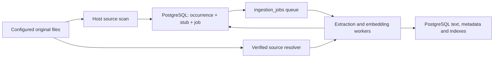

# Ingestion Design

This document is the design authority for Pocket Advisor’s write path: source discovery, discovery, extraction, indexing, queues, failure handling, runtime composition, and ingestion observability. [PDF text extraction](pdf-to-text.md) owns PDF classification, layout reconstruction, rasterisation, and OCR. [Workspace isolation](workspace-isolation.md) owns credentials and store boundaries. [Retrieval](retrieval-design.md) owns the read path over the index produced here.

## 1. Current state

One host Go process discovers original files, admits durable ingestion jobs to a PostgreSQL queue, and runs five stage pools that claim them. Kubernetes supplies PostgreSQL. Directories configured in the private workspace registry are authoritative for original bytes; the application never writes them. PostgreSQL retains normalized text, structured metadata, shared passages, placements, and search indexes. Container members are replayed from their verified original on demand; no extracted bytes are retained outside PostgreSQL.

Document identity is an opaque UUID, independent of its unique per-workspace raw SHA-256. Moves and identical copies preserve that identity; changed bytes create a new content identity. Every indexed passage is an exact UTF-8 byte slice of canonical normalized text. Generated answers never enter the index. Jobs use at-least-once delivery with transactional stage completion.



## 2. Source inventory and identity

### 2.1 Tier 1: original files and replayable members

`source_roots` assigns opaque root IDs to SHA-256 bindings of cleaned absolute configured directories. Absolute directories resolve only from the private registry; bindings and relative paths are private database metadata. Root order does not affect identity. A relocated directory gets a new binding on a complete rescan.

`source_occurrences` records each root-relative path, document UUID, display path, size, mtime, scan ID, observation time, and availability. Identical files retain separate occurrences. `source_scans` records starts and successful completion; only successful full traversal marks old occurrences unavailable. Partial scans may add observations but cannot prove absence. Human display paths include a root basename when multiple roots are configured.

`source_members` records every parent/member-selector/child occurrence, including repeated filenames and shared attachments. MIME selectors are versioned decoded-child ordinals; ZIP and TAR selectors use original member ordinals. `document_placements` remains the complete containment graph used for retention. A single `parent_doc_id` cannot select all sources or establish retention.

A `source:<document UUID>` reference is interpreted only inside the selected workspace. The resolver tries direct occurrences and alternative parent routes, reopens the configured original, and verifies SHA-256 over bytes actually handed to extraction. Every child replay verifies the decoded child's content hash. It never accepts a caller-supplied host path or substitutes changed bytes under an old identity.

Reads use `os.Root` confinement, reject observed symlinks, traversal and special files, apply ignore rules, and compare descriptor attributes before and after reading. Each original is limited to 256 MiB; replay is bounded to eight container levels and 512 MiB of cumulative decoded bytes, including siblings. MIME and archive parsing rejects truncated or over-limit members. Buffers are transient; sources remain read-only. Workers have a bounded handler deadline, and file reads check cancellation between reads.

Missing originals or changed bytes are separate waiting outcomes. PostgreSQL evidence can still be retrieved while an original is offline, but reprocessing and rebuilding require the original hash to be recoverable. Current paths do not preserve overwritten historical bytes: source-side versioning or backups are the operator's responsibility.

### 2.2 Tier 2: PostgreSQL documents

doc_id and raw_sha256 are two independent identities on the same row, not one value serving both purposes:

- `doc_id` is a random UUIDv4 (`domain.NewDocID`), assigned once and never derived from anything — a short, indexable key that lets every other table (chunks, email metadata, placements) cross-reference one document cheaply. It carries no information about content, workspace, or placement.
- `raw_sha256` is the actual content identity: a `UNIQUE` constraint (`documents_raw_sha256_key`) makes it, not doc_id, the idempotency key. `CreateStub` resolves content by a plain read of `raw_sha256` and inserts a candidate doc_id only when the read finds nothing, with `ON CONFLICT (raw_sha256) DO NOTHING` followed by a re-read when a concurrent admission of the same bytes committed first. Re-scanning a workspace, retrying a failed publish, and two racing intake requests for the same bytes therefore all resolve to whichever doc_id first claimed that content — the candidate id a caller generated is only used if the content is genuinely new.

This is what makes moving a file within a workspace, reorganizing a workspace's directory layout, or renaming a workspace itself an ordinary metadata change rather than a re-identification: nothing about a document's identity is derived from where it currently lives.

The `documents` table holds:

- parent/child containment lineage;
- processing status;
- detected type and MIME type;
- source reference, raw content hash, canonical extraction hash and extraction version;
- original filename;
- extracted `normalized_text`;
- email subject, sender, recipients, and date as separate columns; and
- JSON metadata for provenance and failure details.

Email headers are not embedded into body text. `normalized_text` contains body prose, and metadata remains queryable as structured fields.

### 2.3 Tier 3: PostgreSQL chunks

A workspace stores each exact normalised passage once in `chunks`, keyed by its embedding model and `raw_sha256`, a SHA-256 of whitespace-collapsed text — the same content-identity role `documents.raw_sha256` plays one stage earlier in the pipeline, over raw file bytes rather than normalised chunk text. `chunks.chunk_id` is that row's own opaque, randomly generated identity (`domain.NewDocID`-style, independent of `raw_sha256` for the same reason `documents.doc_id` is independent of `documents.raw_sha256`). The row also owns `chunk_text`, its `halfvec(N)` embedding, the HNSW cosine index, and the BM25 lexical index. Similar text is never merged: identity is exact after whitespace normalisation only.

`document_chunks` is the placement relation. Its own identity is `placement_id`, an opaque, randomly generated id (`domain.NewChunkID`, needing no more determinism than `doc_id` does — the same delete-then-insert replace this paragraph describes already makes a re-embed converge correctly regardless of what the new placement ids happen to be). `chunk_id` here is a foreign key naming which shared passage this placement points at — the same name as `chunks`' own primary key, exactly the way `doc_id` names both `documents`' primary key and every foreign key that references it. Alongside `doc_id`, `chunk_index`, and the start and end byte offsets into that document's `normalized_text`, this is what lets retrieval search shared passages, join placements to recover document-specific provenance, and cite the matched placement rather than an arbitrary document sharing the same text. Replacing a document's chunks atomically creates or reuses passage rows, replaces its placements, and removes passages with no remaining placement.

The BM25 lexical index is a `pg_textsearch` index over `chunks.chunk_text` using the `simple` text configuration. It is not part of the base DDL. It remains available during ingestion and is created idempotently after a bounded run drains. Shared passage text still supplies the lexical index; returned candidate text comes from the exact placement slice of the owning document.

### 2.4 Schema bootstrap

The vector width is resolved by probing the configured embedding endpoint. The host applies the schema as the workspace’s own PostgreSQL role and records the embedding model and dimension in the single-row `schema_metadata` table.

Startup verifies that the endpoint’s model and vector width match `schema_metadata`. A mismatch is fatal. The current schema bootstrap is idempotent for an unchanged model and dimension; it is not a schema migration or re-embedding system.

**Target state:** a model change is handled as an explicit re-embed into a distinct model namespace, with the existing namespace remaining queryable until backfill and cutover complete. The migration and backfill workflow is not implemented.

The source inventory, containment, and durable-job tables are applied by the same bootstrap, as a second transactional and repeatable step under its own advisory lock. The queue layout of `ingestion_jobs` is a step inside it that converts an older layout and leaves a current one untouched; reapplication never resets attempts, generations or live leases. The step decides from the table itself — the lease column, the absence of the dispatch columns, the lease constraint and both claim indexes — never from a migration number, because earlier releases wrote rows into `application_migrations` with numbers a later step cannot assume are its own. Ingestion applies the bootstrap under the maintenance lock before any queue query or worker starts, so an older binary and a newer one never consume the same jobs. The step preserves document UUIDs and existing evidence. Extraction records an exact canonical SHA-256 and an `extraction_version` of `canonical-v1`; that version identifies the current canonicalization contract, not a promise of bit-identical OCR across tool upgrades. Containment backfill reads verified originals separately.

### 2.5 Email message metadata

Email messages carry a second layer of Tier 2 state alongside their `documents` row. `documents` keeps the display-form subject, sender, recipients, and date that evidence renders; the tables below keep the structured identities a browse query filters and sorts on. They are parsed facts about what a message says of itself, and nothing groups them: no thread key and no conversation are derived from them.

| Table | Contents |
| --- | --- |
| `email_messages` | one row per message document: canonical `Message-ID`, raw subject, parsed `sent_at`, separate `ingested_at`, bounded automated class and `List-Id`, typed parse warnings, and the parser version |
| `email_addresses` | parsed mailboxes by header kind and header order, each with its normalized address, display name, original raw text, and whether it parsed |
| `email_references` | `In-Reply-To` and `References` identifiers as written, in header order |

Nothing is fabricated. A missing or malformed header produces an empty value and a typed warning; an unparsable mailbox keeps its raw text with an empty address, so no exact mailbox or sender-domain filter can match it and the defect stays visible. `sent_at` is the message's own `Date` and is null when that was absent or unparsable. `ingested_at` is when the row was written; it is the watermark a stable browse cursor pages against and does not move when a document is reprocessed.

Equal `Message-ID`s do not merge documents and do not elect an owner. Both rows are kept, and whether an identifier is currently shared is derived from the indexed rows when a page is read rather than frozen into whichever copy happened to be written first — a second copy ingested later makes the first one shared too, which a stored verdict could never say.

Indexes cover exact address-and-kind matching, exact sender-domain matching, the `sent_at DESC NULLS LAST, doc_id DESC` browse keyset, the `ingested_at` watermark, and `Message-ID` lookup.

One message's metadata is written in a single transaction. There is no workspace-wide lock: the row upsert takes this document's row before its address and reference rows are replaced, which serializes concurrent writes to the same document and leaves unrelated messages free to proceed in parallel. The write is idempotent for a given `doc_id` — mailboxes and reply headers are replaced rather than appended — so re-ingesting a message from verified originals reproduces the same rows.

Exact browse reads these tables, using configured workspace owner identities for direction; its semantics are described in [retrieval design](retrieval-design.md). Reply identifiers are retained as evidence rather than read as a graph: they are the exact claims a message makes about other messages, and a later source-agnostic topic capability may use them as one high-precision signal without treating them as its candidate boundary.

## 3. Discovery and reconciliation

The workspace's `paths` and ordered ignore rules define eligible regular files. Relative roots resolve against the registry directory, and multiple roots require distinct basenames. Each scan fully reads and hashes originals, including unchanged mtime/size observations. A read is trusted only when the file's size and mtime match before and after it and the bytes read match that size, so an identity never hashes a mix of two versions; mtimes compare within one millisecond because some file providers, such as Google Drive for desktop, report sub-microsecond jitter between stats of an unchanged file. An unstable read is retried twice after a short pause. A file still changing is deferred, not admitted: the scan logs its path, continues with the remaining originals, admits everything it read stably, and stays incomplete, so it cannot prove absence. The run then exits with a scan-incomplete error, and the next scan reads the deferred files again. Worker reads apply the same check and park a still-changing original as `WAITING_SOURCE` with reason `SOURCE_CHANGED`. Platform metadata files are excluded. There is no watcher dependency; `--listen` scans at startup and every minute. Changes to registry configuration require restarting the process.

Each accepted original commits its document stub, source occurrence, and next-stage job together. Completed, skipped, and failed documents are not automatically re-extracted, with one exception: a scan settles a known document whose recorded route the current formats (§4) disagree with, judged under the name the document was admitted under, so the same bytes seen under two names cannot flip between routes. Content stored as plain text that now routes to a handler of its own, such as an email whose header block an earlier, shorter look missed, and content skipped at routing as `UNSUPPORTED_FORMAT` that a handler now reads, are rerouted: jobs, canonical text and passages are removed, a passage another document holds excepted, the type is corrected, the document returns to PENDING, and the new route's job is dispatched. A handler that declines content it was sent records the same reason under the job it ran, so only a document with no job counts as skipped at routing; rerouting a handler's decline would repeat it on every scan. Text or an archive that no handler reads any more is recorded SKIPPED with `UNSUPPORTED_FORMAT`, losing its jobs, text and passages and, as a container, its member and placement rows, since its members were a format's parts rather than documents; a member nothing else holds is then unreachable, and `--reconcile-deletions` removes it. All of this happens in the scan's transaction, for staged files and for the members of known containers as they are replayed; identity and locations stay. A document row a handler holds, or one with a running job, is left for the next scan rather than waited for. Binding before a sweep replays containment only and settles nothing. Existing containers are replayed to refresh known member routes. New supported plain text commits canonical text and its embed job together.

Every admitter — the source scan for originals, the email worker for container members — follows one rule: resolve, then link. Content the workspace already holds is found by a plain read and is only linked, through a source occurrence, member route or placement, never written: its stub committed with its job, and its stage handler may hold the document row for the whole extraction. Linking takes only the key-share lock its foreign keys need, which never waits on that handler, whereas any conflict-handling insert or update of the row would wait for it. A reachable known row that has lost its job is re-admitted by the post-scan resume below, not by the admitter that met it. Only content the read does not find is inserted, and that insert can wait only for another uncommitted admission of the same new bytes. The first to commit keeps the row and later admitters link to it. A handler admits a container's members in ascending `raw_sha256` order, so these waits follow one global order and cannot form a cycle. An abort that PostgreSQL makes to break an unforeseen deadlock is still a returned job, not a failure (§6.1).

Discovery reads one original at a time and writes reference-only jobs to the durable queue. It never waits for a queue-depth threshold. The workers run while the scan admits, so extraction and embedding overlap the scan's reads. A job commits together with the source occurrence it reads, so work admitted by the scan always resolves. Leftover work for a renamed original can reach a worker before the scan has reached its new path; it parks as `WAITING_SOURCE` and is retried once the scan completes and locations are current. The backlog grows in proportion to the admitted collection; worker concurrency, job transaction slots, and container expansion limits bound active processing independently of its size. A complete scan then marks every original it did not observe unavailable and refreshes each document's derived display path from its current occurrences. The refresh writes only documents whose path changed and skips a row a handler holds rather than waiting for it, since handlers keep their document row for the whole extraction and an update waiting on one would hold every row it had already locked, stalling the other handlers behind it; a skipped document is refreshed by the next scan.

Ingestion is additive: it admits and processes, and never deletes. `--ingest-all` and `--reconcile` run the same path: one source scan, which also refreshes known locations, followed by a retry of source waits and a drain. Work a dead process left RUNNING needs no startup step: its lease expires and a pool claims it like any other job. Only `--ingest-all` accepts `--dry-run`. `BindExisting` is the non-admitting source refresh used by the explicit maintenance commands. A `PENDING` or `PROCESSING` document row that has no durable job at all and is reachable from the completed scan is re-admitted: straight to embedding when it already holds normalized text, and through classification of its verified original otherwise. A jobless row whose original is gone is left for the sweep in §6.4 rather than resumed into a missing source. Terminal failures require explicit recovery.

`--ingest-all --dry-run` only hashes configured files and reports file/byte counts. It opens no database or model connection and writes no derived state.

## 4. Routing and extraction

Discovery classifies bytes rather than trusting extensions. The routes below are one declared table of the formats each handler reads, tried in order: the first entry that claims the detected type, or one of its ancestors, decides, so content no handler reads is declined rather than sent anywhere. A file name never makes a claim, since extensions lie; it only narrows one, for the two families whose bytes say too little: text, where a log, source code or a data file is as much text as a letter, and zip, which many formats are built on. An RFC 822 message that the type detector reads as plain text, as mail clients' exported `.eml` files often are, is still recognised from its header block — everything before the first blank line, read up to 64 KiB, since delivered mail's trace and signature chains push its fields past the first few kilobytes: it needs a From field, a Subject or Date field, and a Message-ID, Received or MIME-Version field, each at the start of a line.

| Detected content | Subject | Handler |
| --- | --- | --- |
| RFC 822 email | `ingest.emails.raw` | email worker |
| plain ZIP, tar, and gzip archives | `ingest.emails.raw` | container unrolling |
| zip-based formats: those detected as their own type, such as EPUB, JAR, APK and OpenDocument other than ODT, and those named as Apple iWork documents, Wallet passes, comic books, KMZ, or browser, IDE and app packages | none | `SKIPPED / UNSUPPORTED_FORMAT` |
| gzip named as a compressed metafile or SVG (`.emz`, `.wmz`, `.svgz`) | none | `SKIPPED / UNSUPPORTED_FORMAT` |
| detected 7z and bzip2 archives, and gzip holding no tar | `ingest.emails.raw` | `SKIPPED / UNSUPPORTED_FORMAT` during unrolling |
| PDF | `ingest.pdfs.raw` | document worker |
| DOCX, XLSX, PPTX, ODT, RTF | `ingest.docx.raw` | office worker |
| image | `ingest.images.raw` | image viability and OCR |
| plain text, Markdown, CSV, TSV, HTML, iCalendar, vCard, and XHTML named `.html`, `.htm` or `.xhtml` | `ingest.text.embed` | direct indexing |
| code and data formats the detector names, such as JSON, XML, JavaScript, Python, Perl and PHP, and plain text named as a log (rotated ones included), source code, or a data or configuration file | none | `SKIPPED / UNSUPPORTED_FORMAT` |
| CFBF Office and Outlook MSG | none | `SKIPPED / UNSUPPORTED_FORMAT` |
| other unsupported content | none | `SKIPPED / UNSUPPORTED_FORMAT` |

### 4.1 Email and archive worker

The email worker parses RFC 822 messages and supported archives in memory. It:

- extracts and compacts body text;
- strips markup, quoted reply chains, signature boilerplate, and machine-generated tracking URLs over the configured structural threshold;
- records headers in structured columns;
- persists the durable message metadata described in §2.5;
- records child replay selectors and containment without persisting child bytes, for every member including those whose content is already known;
- gives every member a valid UTF-8 name without NUL (below);
- admits members in content-hash order, creating stubs and downstream job intents only for content it is first to admit (§3), all committed with the parent stage;
- reads an archive's format from its bytes, never its name: ZIP and gzip by their signatures, anything else as a tar;
- leaves out members the workspace's ignore rules exclude by name, recording nothing about them;
- enforces nesting and expansion bounds for hostile containers; and
- declines an archive it cannot unroll, logging the unrolling error, since the verified bytes fail the same way on every attempt.

Each cause of an archive decline has its own reason. Nesting past eight levels is `RECURSION_LIMIT`. Expansion past one hundred times the archive's size, at most 512 MiB, or more than 2000 members is `ARCHIVE_TOO_LARGE`. A ZIP with a password-protected member is `ARCHIVE_ENCRYPTED`, since the system never holds passwords. Damaged structure or compressed data is `ARCHIVE_DAMAGED`. A format the unroller does not read — 7z, bzip2, a gzip stream holding no tar, or a ZIP member under a compression method Go does not provide — is `UNSUPPORTED_FORMAT`. A gzip stream is told from its content by watching the decompressor: a tar header that fails over intact data is no tar when it is the first, and damage after that. An unrolling error none of these name fails the document as `UNCLASSIFIED`.

Child commands carry `parent_doc_id`, depth, and the parent trace id. Root creation remains exclusive to discovery.

The header is read strictly first. Legacy mail sometimes carries a header line that names no field: a raw 8-bit subject broken by a bare newline leaves its tail on a line of its own, and a message missing the blank line before its body has the body's first line at the end of the header. A message the strict reader rejects is read once more with that line joined to the field before it when another field follows, or taken as the start of the body when none does, and each repair is a `malformed_header_line` warning; a message that still fails, or whose first line names no field, fails with `EMAIL_PARSE_FAILED`. Header values are meant to be ASCII with RFC 2047 encoded words, and a value written as raw 8-bit text is read under the charset the message declares for its text when that reading is plausible, by the same test member names use (below), or has its invalid bytes replaced with U+FFFD; each such header is an `undeclared_charset` warning. Header values are never detected under other encodings. A decoded header or body can still hold text PostgreSQL cannot store: a NUL, or half of a UTF-16 surrogate pair that a mailer encoding an emoji wrote as UTF-8 inside an encoded-word declaring UTF-8, which is not UTF-8. NUL is removed and such a sequence becomes U+FFFD, in raw header values, decoded subject, sender, recipient and display names, and the body; each affected header, or the body, is an `unstorable_text` warning.

Member names come from the container, and older containers store them as bytes in an unrecorded code page: a ZIP from a DOS or Windows tool carries an OEM code page such as CP866 without the UTF-8 flag, and a mail client may put raw 8-bit bytes in a filename parameter. A name is taken from the most authoritative source available: valid UTF-8 as given (which covers the ZIP UTF-8 flag and tar PAX paths), an Info-ZIP Unicode Path field whose CRC matches the header name, an RFC 2047 or RFC 2231 name under its declared charset of any kind, or raw 8-bit bytes under the charset the message declares for its text when that reading is plausible. Otherwise the container's undeclared names are decoded together as one sample under each candidate legacy encoding: the Cyrillic, Central and Western European DOS and Windows code pages, KOI8, ISO-8859-5, Mac Cyrillic, Shift-JIS, GBK, Big5, and EUC-KR. A reading scores by the share of its non-ASCII characters that are ordinary letters in well-formed words of one script. Its Han characters must also come from the candidate encoding's most frequent tier. An encoding is accepted only when its reading scores at least 0.7 and leads every differing reading by at least 0.15. Otherwise invalid bytes become U+FFFD. Archive paths are decoded before the folder part is dropped, because a Shift-JIS, GBK or Big5 character can end in the backslash byte. A new member document whose name was decoded or replaced this way records the original bytes as hex in `metadata_headers.source_name_raw` and the encoding in `source_name_encoding` (`unknown` when replaced). Names are not indexed evidence and the original is kept, so a wrong reading is cosmetic and recoverable; member identity is the selector and content hash, never the name. Text attachments are held to the same canonical-text rules as staged plain text (§6.4): invalid UTF-8 is SKIPPED with `UNKNOWN_ENCODING` and NUL with `NUL_BYTES`.

### 4.2 PDF and image worker

The document worker has separate PDF and image consumer pools sharing one extraction implementation and one process-wide CPU semaphore. PDF extraction, masking, layout, rasterisation, OCR, page ordering, and image viability are specified in [PDF to Text](pdf-to-text.md).

OCR is compiled behind the `ocr` build tag. The supported build command enables it. A binary built without that tag remains usable but records scanned PDFs and images as `SKIPPED / OCR_UNAVAILABLE`.

### 4.3 Office worker

The pure-Go office worker handles:

- DOCX paragraphs and row-wise tables;
- XLSX sheets and tab-separated rows, using cached formula values;
- PPTX slide text and notes;
- ODT text; and
- RTF control-word stripping.

Row-wise spreadsheet output preserves the relationship between fields such as dates, descriptions, and amounts.

### 4.4 Plain text

Discovery writes supported plain text directly to `documents.normalized_text` before publishing `EmbedTextCommand`. Commands carry references, not document content.

## 5. Commands and queues

Every ingestion command is Protobuf and begins with `DocumentMetadata` containing document identity, lineage, MIME type, content hash, trace context, and container depth.

| Command | Subject | Payload role |
| --- | --- | --- |
| `ProcessEmailCommand` | `ingest.emails.raw` | source reference and metadata |
| `ProcessPdfCommand` | `ingest.pdfs.raw` | source reference and metadata |
| `ProcessOfficeCommand` | `ingest.docx.raw` | source reference, subtype, metadata |
| `ProcessImageCommand` | `ingest.images.raw` | source reference, dimensions, size, metadata |
| `EmbedTextCommand` | `ingest.text.embed` | document reference and text length |

Extracted text is written to Tier 2 before an embed job is enqueued. This keeps large OCR output out of job rows, which are copied on every claim, retry and recovery, and gives `normalized_text` one durable owner.

The five subjects name the stage queues; they are values of `ingestion_jobs.subject` and need no provisioning. Every command carries its source reference in field 10; field 2 is permanently reserved and must not be reused.

## 6. Durable handoff, failure and retention

### 6.1 The PostgreSQL job queue

`ingestion_jobs` is the durable work record and the queue. Its unique identity is document, stage subject, and content revision; embedding also binds the canonical-text hash. Payloads contain references and metadata, never document bodies. A job is READY, RUNNING, COMPLETED, FAILED or WAITING_SOURCE, and carries a generation, a count of charged attempts (0 through 3), the time it becomes available, a lease expiry while RUNNING, and the closed reason of its latest processing failure, kept apart from the diagnostic of a source wait. Enqueueing commits with the rows that make the work resolvable and notifies at that commit.

**Claiming.** Each pool has one claimer. It reserves only as much of the process-wide gate as it has idle lanes and the gate has free slots, never waits while holding part of a batch, and releases whatever a claim does not use at once. READY jobs whose delay has elapsed and RUNNING jobs whose lease has expired are claimed by separate short `FOR UPDATE SKIP LOCKED` statements, committed before any handler runs. Each follows its own partial index — `(subject, available_at, created_at, job_id)` for READY work and `(subject, lease_until, created_at, job_id)` for expired work — with the wall time materialized once so it is a usable index bound, so neither statement sorts its eligible backlog. With several reservations one expired claim is tried before READY work fills the rest; with one reservation the two states alternate as the first choice, so neither a continuous READY backlog nor a large expired backlog starves the other. A claim sets RUNNING, increments the generation, charges an attempt and grants a five-minute lease. Fresh work is first-in first-out by availability; a retried job queues behind work that became available earlier.

**Waking.** A pool waits for a free lane, released gate capacity, a notification, the next due time, or a five-second fallback poll. One fixed channel per database carries empty notifications from enqueue, retry, return and recovery commits, and a notification wakes every pool. Notifications are hints. A once-a-second grouped depth sample also reports each subject's earliest READY availability and RUNNING expiry; a pool schedules its next look at that instant when it is sooner than the fallback, and an unchanged past-due hint is consumed once rather than obeyed repeatedly, so an idle pool issues about one claim per five seconds. A dedicated LISTEN connection, outside the application pool and on the workspace's own DSN, is established before the first claim; if it is lost, polling continues while a bounded-backoff reconnect loop runs, and each reconnect wakes the pools once.

**Ownership.** A handler's lease renews every thirty seconds on its own connection, capped at one hour from claim time, which is also the handler's deadline. Renewal that matches no row is confirmed loss and cancels the handler at once. A database error leaves ownership uncertain, so renewal retries with jitter while a conservative local estimate — the request's start time plus the remaining lease the database reported — leaves more than a thirty-second margin; only when no confirmation arrives inside that window is the handler cancelled and its claim left to expire with the attempt still charged. Database time stays authoritative: an expired lease rejects renewal and completion even when no successor has claimed the job. Cooperative cancellation cannot release a lane occupied by an uninterruptible native call; the handler is never detached and its lane and gate slot are never reused while it runs. If it stays stuck its ownership expires and it cannot commit, and process termination is the supported way to free the lane.

**One transaction per handler.** The handler runs in one READ COMMITTED transaction that holds the job's advisory lock — mutual exclusion with an expired handler still physically running — and takes no job-row lock, so renewals proceed. Its writes, child and embedding jobs, and the completion statement commit together. The completion statement is the ownership fence: it requires the job's ID, expected generation, RUNNING state, an unexpired lease and the handler budget, and matching no row rolls back everything. Every other verdict — decline, retry, failure, source wait, return — is a short transaction under a fresh deadline with the same predicate. A verdict that cannot be recorded is logged and left for expiry; it is never repeated blindly or followed by a different transition. Document status commits only with a successful job fence, and the document row is updated before the job row so a verdict never waits on a document lock while holding a job-row lock an older handler's completion needs. An uncertain commit is resolved from durable state before anything is counted.

**Attempts and outcomes.** An attempt is charged at claim, so a crash spends one like an error does; an interruption does not establish a parser or input failure, and the budget is not a lifetime claim count.

| Outcome | Transition |
| --- | --- |
| Success | COMPLETED with the stage's writes |
| Declined input | document SKIPPED and job COMPLETED together |
| Transient failure below three attempts | READY after a jittered exponential delay (a nominal sixty seconds doubling to five minutes, in the upper half of that interval); the attempt stays charged and the closed reason is recorded |
| Terminal failure, or a third transient failure | job and document FAILED together; payload and reason retained |
| Spent budget at claim | FAILED without running a handler, with the last closed reason or UNCLASSIFIED |
| Busy advisory lock | READY after thirty seconds; the attempt is refunded if this claim charged one |
| Deadlock abort | READY after a jittered two-and-a-half to five seconds; the attempt is refunded |
| Shutdown or cancellation | READY at once; the charged attempt is refunded |
| Missing or changed original | WAITING_SOURCE with a closed reason; the charged attempt is refunded and earlier failures kept |
| Handler panic | FAILED with `HANDLER_PANIC` |
| Lost or unconfirmable ownership | no verdict; expiry or the successor resolves the job |
| Process crash | no transition; the lease expires and the next claim charges the attempt |

A refund happens only in the fenced transition that leaves RUNNING, so it cannot happen twice. Complete scans resume WAITING_SOURCE to READY with the charged attempts retained; partial scans do not. Explicit recovery resets only selected jobs to a fresh cycle of zero attempts. Completed jobs stay complete.

The handler transaction is held through extraction and model work, bounded by the one-hour handler deadline. That favours atomicity and requires watching long transactions and vacuum pressure. A process-wide gate of `max_conns − 3` slots bounds open stage transactions independently of lane count: one reserved connection holds the maintenance lock, two serve scanning, claims, renewals, verdicts and depth samples, and the listener sits outside the pool. Ingestion therefore requires at least four connections. Moving expensive work outside the stage transaction remains a future design concern and must preserve the same commit guarantees.

### 6.2 Failures and recovery

Expected declines commit SKIPPED. Transient failures return the job to the queue after the jittered delay above, long enough to outlast the embedding endpoint's circuit-breaker cooldown, so a failing dependency cannot spend a document's three attempts in milliseconds. A transient failure with a known cause records it as the job's reason, so a job whose attempts run out keeps a retryable reason recovery selects: an embedding endpoint that returns no vectors — unreachable, timed out, answering with an error or behind an open circuit — is `EMBEDDING_UNAVAILABLE`. An unnamed error is `UNCLASSIFIED`. A value PostgreSQL refuses for its content (SQLSTATE class 22) is refused again on every attempt, so it fails the job at once as `STORE_REJECTED`. Terminal failures, and errors on the third charged attempt, record FAILED job and document state atomically, behind the job's advisory lock: an expired handler of the same job that still holds it makes the verdict a busy return, with an exhausted claim keeping its spent budget. The failed-job counter counts only newly committed outcomes. A missing or changed source records WAITING_SOURCE with a closed reason. Complete listener scans retry source waits; an explicit reconciliation also retries them. No changed bytes replace the expected revision. A finite run reports unfinished work, source waits and jobs that failed during the run as unresolved. Jobs that had already failed before it started are reported in the run summary but do not make it unresolved: ingestion never retries a failure on its own, so they would otherwise end every later run unresolved until each was fixed or removed. `--recover` is what retries them.

A process crash before stage commit leaves no partial stage effects. Its jobs stay RUNNING until their leases expire, then are claimed again with the attempt charged, so a restart after a kill waits out the remaining lease — up to five minutes — before that work resumes; three crashed attempts fail the job without a fourth handler. The workspace maintenance lock belongs to its own database session, and losing that session cannot prove that old handler transactions have ended, so startup never bulk-resets RUNNING jobs. A crash after commit leaves a COMPLETED job. `--recover --yes` resets only planner-approved documents and their unfinished or failed jobs; completed jobs stay complete.

### 6.3 Diagnosis and recovery planning

`--doctor` is a read-only diagnosis of one workspace that writes to nothing. It resolves the registry entry and the workspace's credentials, pings PostgreSQL and the configured source roots, compares the configured embedding model and dimension against `schema_metadata`, and checks the `vector` extension, the document and chunk tables, and the HNSW and BM25 indexes. It then proves the queue layout and, only if it is current, reports jobs per state, RUNNING jobs whose lease expired, unfinished jobs whose budget is spent, FAILED jobs grouped by reason and jobs waiting on originals; it counts documents with no observed source, `PENDING` and `PROCESSING` rows older than thirty minutes — a document whose job holds an unexpired lease is working, not stale — a handler's own status writes stay in its open transaction, so a document being processed often still reads `PENDING` — `FAILED` and `SKIPPED` rows grouped by reason, and signs of an interrupted reset. On the current layout each `FAILED` reason, and each password-protected `SKIPPED` reason (`PDF_ENCRYPTED`, `ARCHIVE_ENCRYPTED`), names its documents the way the run summary does, most recently updated first: ten per finding in the text report, all of them under `--json`. A failure with no job was recorded before the job queue, and its finding says how many such failures `--recover` reruns; a password-protected finding tells the owner to save an unlocked copy under a configured root. The `UNSUPPORTED_FORMAT` finding is broken down by detected type, without parameters, and the file name's last extension, lowercased — the detected type alone is too coarse, since `application/octet-stream` covers every format the detector does not know — largest group first, naming three documents of each in the text report and all of them under `--json`. On the older layout it reports `QUEUE_SCHEMA_UPGRADE_REQUIRED`, naming ingestion as the step that applies the schema, and runs no job query. Live RUNNING work appears in the queue summary, not as a finding.

Each finding carries a stable code, a severity of info, warning, error or critical, an affected count, a summary that contains no content, filename or credential, and one next action. `--json` emits the whole report. The exit status is 0 for healthy, 1 for unhealthy but diagnosed, and 2 for a doctor run that could not complete.

`--recover` classifies documents rather than describing the workspace. Its planner is read-only: every selected document becomes one item with a classification — retryable, terminal, converged or not recoverable — and one action: transition to pending, reset to pending, rebuild the BM25 index, converge an incomplete reset, no action needed, or refused. Each item carries the document's unfinished and failed jobs with their generation and state. A document whose job holds an unexpired lease is refused, and the apply step revalidates every job's generation, state and lease inside its own transaction: a changed item is refused without mutation. Each job's advisory lock is tried first and never waited for, under the control deadline, so recovery refuses at once rather than block behind an expired handler that is still running. Applying resets the document and only its failed and expired jobs to a fresh retry cycle and notifies at commit; queued jobs — delayed retries included — source waits and completed jobs are untouched, keeping their recorded failures, budgets and backoff. A validation failure stops application, and recovery refuses to run before the queue schema is current. Recovery runs under the maintenance lock. Failed documents are selected in the query itself by a retryable reason, by an expected-decline reason, or by having no job at all. Declines are recorded SKIPPED, so a failure carrying one was recorded by a handler that predates the decline; it is planned retryable and run again so the current handler settles it. A failure is recorded together with its failed job, so one with no job was recorded before the job queue, and whatever its reason it is planned retryable: reset to PENDING, it is resumed by the next ingestion like other work from before the queue when its source is reachable, and a failure then is recorded with its job. A stale PENDING or PROCESSING document whose jobs are all still queued or waiting for their source has nothing to reset, and is planned converged with no action rather than retryable. Each state contributes at most 500 documents to a plan; a selection that reaches that cap says so on stderr, and applying the plan then running `--recover` again selects the next batch. `--reason` replaces that selection with every FAILED document carrying one of the comma-separated reasons it names, whatever their class, and plans each retryable: naming a reason is the operator's judgment an unclassified or terminal reason waits for. `--reason all` selects every FAILED document, whatever its reason, together with the stale PENDING and PROCESSING documents of the default selection, and plans every failure retryable. Without `--yes` the plan is reported and nothing changes.

### 6.4 Pruning and maintenance

A workspace-scoped advisory maintenance lock serializes ingestion, binding, recovery, forgetting, and destructive sweeps.

`--reconcile-deletions` is the only sweep, and it runs as its own command, never inside ingestion. With no worker running, nothing can add a document or a containment edge while a plan is judged. It refreshes known source locations, prepares the containment backfill if necessary, inventories the hashes of current originals and of their expanded members, and removes documents unreachable from that inventory through all `document_placements` edges. Members the workspace's bare-name ignore rules exclude are not expanded or inventoried, and an edge into content seen only as such a member is not followed, so a staged message no longer holds an ignored attachment or anything inside it; the same bytes staged under a kept name are still held. Duplicate originals and shared or nested members survive while any configured route retains them. Processing status is not a retention mark: a failed or waiting job neither protects its document nor blocks the sweep, and an unreachable document's jobs go with it.

The sweep requires a complete root traversal, a nonempty source set, and complete containment backfill. Missing or unreadable roots fail it. The preview may refresh derived state but never deletes documents or writes originals. Applying requires `--yes` and a typed confirmation of the displayed plan. There is no percentage limit: the operator's review of the plan is the check against a directory that failed to mount or a sync that has not finished, beyond the refusal of an empty source set.

Until the sweep runs, documents whose originals were deleted or newly ignored remain retrievable. Their outstanding jobs wait for a source, so ingestion reports them as unresolved and names the sweep.

Canonical text must be valid UTF-8. The sniffer routes anything text-shaped for indexing and labels undecodable bytes `iso-8859-1` by assumption, not by declaration, so admission checks the bytes and records SKIPPED with `UNKNOWN_ENCODING` rather than decoding on that assumption or ending the scan. NUL is valid UTF-8 that PostgreSQL text cannot hold, so plain text containing it is recorded SKIPPED with `NUL_BYTES`; stripping it would make canonical text differ from its source. Any other admission that PostgreSQL refuses for its values (SQLSTATE class 22) rejects only that file: discovery logs it, continues, and leaves the scan incomplete. Other admission errors still end the scan, because they say nothing about one file. Extraction workers make their text storable first. Text extracted from an Office document, PDF or image is derived rather than canonical source bytes, so NUL characters an extractor carries over from the binary format are removed and logged; a plain text file's own bytes are its canonical text, so NUL there declines it as above. An email worker reaching the same refusal fails that one document as `STORE_REJECTED`. A message body is decoded under the charset its part declares, looked up by any of its names with stray quotes removed. Every IANA name of US-ASCII reads as ASCII, never as Windows-1252, so a body declaring ASCII, UTF-8 or no charset must be valid UTF-8, and a body that is not, or that declares an unknown charset, fails the message with `UNKNOWN_ENCODING`. Encodings of text are never guessed: a wrong guess yields valid UTF-8 from wrong bytes, which is silent corruption of indexed evidence rather than a loud, actionable failure. Container member names are the one exception, because they are not indexed evidence and keep their original bytes (§4.1).

A staged container whose members cannot be re-derived — malformed multipart, unknown charset, corrupt archive, or a replay budget exhausted by one file — is counted and reported, not fatal. Containment authority is `document_placements`, whose completeness is already a precondition above; re-expansion during a sweep is a redundant second reading of the same fact. A container unparsable now was equally unparsable at admission and contributed no member documents, and one that parsed then retains its members through the placement graph. Real corpora carry a steady fraction of these, so a fatal traversal would refuse the sweep rather than protect anything. The count appears in the plan and in `--reconcile-deletions --json`; each container is named at debug level in the retention log.

Deletion removes derived rows, their jobs and placements, and unreferenced passages in a transaction. The parent foreign key is `ON DELETE SET NULL`; surviving display provenance is repointed where possible. Source occurrence/member tables provide the full citation paths. No object cleanup queue exists.

## 7. Chunking and embedding

The indexer loads `normalized_text` by `doc_id`, then:

1. splits it into approximately 512-token windows with 64-token overlap;
2. prefers paragraph, line, sentence, then word boundaries in the final 40% of a window;
3. preserves UTF-8 byte offsets so `normalized_text[start:end] == chunk_text`;
4. batches after chunking, with at most 64 chunks or approximately 16,000 tokens per embedding request;
5. embeds exactly `chunk_text`, without subject, filename, or parent context; and
6. replaces all chunks for the document transactionally.

A document may require several embedding requests, but no chunks become visible until the complete document transaction commits.

## 8. Process topology and concurrency

One process constructs shared store clients, model clients, logging, metrics, and a CPU semaphore. Pool sizes derive from `runtime.NumCPU()`:

| Pool | Lanes |
| --- | --- |
| email | `2 × CPU` |
| PDF | `CPU` |
| image | `CPU` |
| office | `CPU` |
| embedding | `2 × CPU` |
| rasterisation and OCR CPU semaphore | `CPU` shared slots |

Embedding concurrency is separately configurable because it is a capacity limit of the model endpoint rather than the host CPU. The database job gate limits concurrent stage transactions independently of lane count.

PDFium uses the wazero WebAssembly backend. Its instance pool is lazy and sized to the document lanes. Tesseract uses CGo. PDF rasterisation remains serial per document, while page OCR can run concurrently under the shared semaphore and stores results by page index.

## 9. Run lifecycle

A finite run starts all stage pools, the queue listener and the depth sampler, and runs discovery beside them. When the scan completes it resumes reachable jobless work and retries source waits. It then waits for the queue to hold no READY or RUNNING job — delayed retries and expired claims included — and every lane to be idle for three seconds; a failed depth sample is not an empty observation. If source waits remain it retries them once more, since a worker can record a wait just after the first retry, and drains again. It then stops claiming, joins every worker, the sampler and the listener, and creates the search index. If the scan fails, work already admitted is still drained and the scan error is reported. READY, RUNNING and WAITING_SOURCE jobs, and jobs that failed after the run started by the database clock, are reported as unresolved; jobs that failed earlier are reported only in the run summary. The run then prints that summary, read from the store with the same start time so an interrupted or failed run reports correctly: files its scans observed and new originals; documents it created or finished a job for, by status and reason, which includes documents discovery settled without a job; unfinished jobs, source waits, failures from this run and earlier ones by reason, and password-protected documents (`PDF_ENCRYPTED`, `ARCHIVE_ENCRYPTED`); every `UNSUPPORTED_FORMAT` document in the store, grouped by type as `--doctor` groups it, at most fifteen groups with one example each; and, at most fifty by name, every failed document and this run's password-protected ones, each by its original's path or, when it has no available original of its own, as a member of a container that still holds one — the container it came from first, else any other from its containment. A summary that cannot be read is reported on stderr and does not change the run's outcome. A listener performs the same initial source scan, then scans periodically alongside workers and runs until interrupted.

The first interrupt stops intake and claiming while handlers drain. A second interrupt or grace-period expiry cancels handlers; each cancelled job returns to the queue with its attempt refunded. Downstream jobs committed during shutdown remain durable for the next run.

## 10. Reset semantics

`--forget <sha256>` removes the selected document and exclusively held descendants from derived state, retains independently present or shared descendants, and collects orphan passages. It never edits an original. A later scan can reintroduce still-configured bytes; persistent exclusion belongs in `ignore`.

`--delete-data` clears documents, email metadata, passages, source inventory and jobs in one PostgreSQL transaction under the maintenance lock. Original files and configuration remain unchanged. A job removed by a reset or sweep cannot resurrect its document: every verdict requires the job row it claimed.

## 11. Observability

Ingestion exposes Prometheus metrics on the configured host port and writes JSON logs by role under the configured log directory.

Implemented metrics include:

| Metric | Purpose |
| --- | --- |
| `rag_discovery_files_total{mode,outcome}` | discovery and reconciliation outcomes |
| `rag_ingestion_tasks_total{worker,status}` | worker terminal outcomes |
| `rag_ingestion_duration_seconds{worker,doc_type}` | stage latency |
| `rag_pdf_classification_total{type}` | digital and scanned routing |
| `rag_office_extracted_total{format}` | office extraction throughput |
| `rag_skipped_total{reason}` | expected declines |
| `rag_dlq_total{worker,reason}` | newly committed FAILED outcomes |
| `rag_job_leases_lost_total{worker}` | claims abandoned because ownership was lost or could not be confirmed |
| `rag_embedding_tokens_processed_total` | approximate embedding volume |

The process creates and propagates W3C `traceparent` values and records their trace ids in logs. It does not currently export spans to an external tracing backend.

Ingestion prints nothing live; progress is read from the role logs and the Prometheus metrics. `--query` and the `mcp` subcommands log to stderr instead of role files. Current ingestion logs include local source paths and filenames for diagnosis; `logs/` is gitignored and must be treated as private workspace material.

## 12. Deployment boundary

The chart deploys only PostgreSQL. Workspace provisioning creates the database, role and extensions. The host process reads configured original directories and uses only its fixed workspace's clients. Source access, authentication, and the local trust model belong to [workspace isolation](workspace-isolation.md).

An authenticated future control plane may dispatch operations to a host agent using this same bounded process. Moving extraction elsewhere requires deliberate, confined access to originals and local models; it is not implied by the target API.

## 13. Verification

The supported checks are documented in [README §10](../README.md#10-verification). Ingestion changes normally require:

```sh
./pocket-advisor.sh build
./pocket-advisor.sh test
./pocket-advisor.sh race
./pocket-advisor.sh lint
git diff --check
git status --short
```

Synthetic integration checks cover concurrent admission of shared content, stage rollback, concurrent claims, expiry and reclaim, stale-verdict fences, refunds, crash exhaustion, notification and reconnect, queue schema upgrade, recovery revalidation, source schema migration, partial scans, shared locations, unchanged second ingestion, rename identity, hybrid retrieval, and derived-only reset. Source tests cover content changes preserving size/mtime, alternative container routes, repeated member names, replay bounds, missing roots, traversal, symlinks, and cross-root scope. Run manual tests only against a disposable PostgreSQL as described in the README.

## 14. Open decisions

- A resumable model/extractor namespace upgrade needs deliberate revision fingerprints and cutover; it is not automatic re-embedding.
- Measure long-transaction contention, query latency during ingestion, and container replay costs before increasing concurrency.
- Define a source-version retention and coordinated database/source backup policy. One local replica is not a backup.
- Watcher acceleration and configurable scan intervals can follow measured freshness and I/O needs.
- Define log rotation and measure whether expensive handler work should move outside stage transactions while preserving the queue's commit guarantees.
